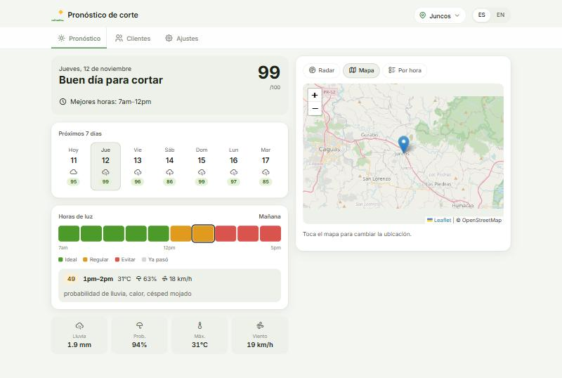
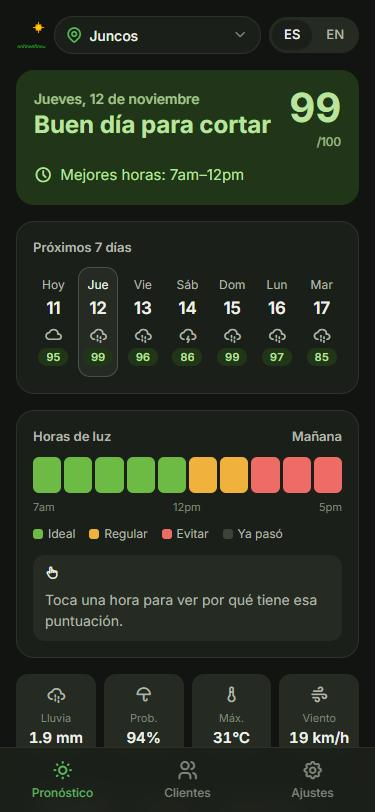

# Lawn Mowing Forecast

Know at a glance whether today is a good day to mow, and at what time. A mobile-first web app that scores every daylight hour of the next 7 days from the weather forecast, and keeps a list of clients with their next good mowing day.

**Live:** https://trukitro.github.io/lawn-mowing-forecast/





---

## Features

- **Verdict first:** a large card answers "should I mow today?" with a 0–100 score, a color, and the best hours left today.
- **7-day strip:** each day with its weather and score. Tap a day to see its details.
- **Hour bar:** every daylight hour (sunrise to sunset) colored ideal, fair or avoid. Tap an hour to see why it scores that way.
- **Smart score:** rain, chance of rain, wet grass from recent rain, heat (feels-like), strong UV, wind and thunderstorms all count. See [How the score works](#how-the-score-works).
- **Location search:** all 78 Puerto Rico municipalities offline, plus worldwide place search, your device location, or tap a point on the map.
- **Radar, map and hourly table** in tabs next to the forecast.
- **Clients:** name, phone, address, town and an exact pin on the map. Each client shows their **next good day** and last service. Log services, get directions, or open the forecast at the client's address.
- **Day plan:** "Who can you visit tomorrow?" groups your clients into good, fair and better another day for any of the next 7 days, puts the most overdue first, shows each one's best window, and opens a driving route in Google Maps through the good ones (nearest stop next, up to 10 stops).
- **Backup:** export and import your clients as a JSON file. Settings shows the date of your last backup, and the Clients tab reminds you when you've never backed up (a week after your first client) or the last backup is more than 30 days old.
- **Settings:** English or Spanish, °C/km/h/mm or °F/mph/in, and light, dark or automatic theme. Everything is remembered.
- **Installable app (PWA):** add it to your phone's home screen or install it on desktop from **Settings → Install the app**. It opens without a connection and shows the last forecast it loaded.
- **Shareable links:** open the app at specific coordinates with `?lat=18.23&lon=-65.92`.

Clients are stored only in your browser (`localStorage`). They never leave your device unless you export them. Keep in mind:

- They're per device and per browser. On iPhone, the installed app and Safari keep separate data; move clients between them with export and import.
- Clearing your browsing data or using a private window removes them.
- The app asks the browser for persistent storage when you save data (and right away in the installed app), so it isn't cleared when space runs low. Settings shows whether the browser granted it.

---

## How the score works

Each full daylight hour starts at 100 and loses points:

| Factor | Penalty |
|---|---|
| Rain falling in that hour (> 0.1 mm) | 40 per mm, up to 60 |
| Chance of rain | half the percentage (100% → −50) |
| Wet grass: rain in the previous 3 hours | 25 per mm, up to 40 |
| Soaked ground: more than 10 mm in the previous 24 hours | −10 |
| Heat: feels-like above 32 °C | 5 per degree |
| Cold: feels-like below 15 °C | 4 per degree |
| UV index above 8 | 4 per point |
| Wind above 30 km/h | 2 per km/h |
| Thunderstorm | −50 |

**70 or more is ideal, 45–69 is fair, below 45 is best avoided.** A day's score is its best 3 consecutive hours, since a typical job needs a window, not a single good hour. The logic lives in [`js/score.js`](js/score.js) and is covered by tests.

---

## Getting started

No build step. It's plain HTML, CSS and JavaScript modules.

```bash
git clone https://github.com/Trukitro/lawn-mowing-forecast.git
cd lawn-mowing-forecast
python -m http.server 8000
```

Then open http://localhost:8000. JavaScript modules need a web server; opening `index.html` directly from disk won't work.

Run the tests (Node 18 or newer):

```bash
npm test
```

Publishing on GitHub Pages: **Settings → Pages**, source **main** branch, root folder.

The service worker fetches app files from the network first, so a new deploy shows up on the next load. When you add, rename or remove a file under `js/` or `css/`, update `SHELL_FILES` in `sw.js` and bump `VERSION`.

---

## Project structure

| Path | Purpose |
|---|---|
| `index.html` | App shell: header, navigation, the three views and the sheets |
| `css/styles.css` | Design tokens (light and dark), layout and components |
| `js/app.js` | Startup and routing (`#forecast`, `#clients`, `#settings`) |
| `js/score.js` | Mowing score: pure functions, no DOM |
| `js/forecast.js` | Forecast view: verdict, days, hour bar, tabs |
| `js/clients.js` | Clients view, client detail and form |
| `js/settings.js` | Settings view: language, units and theme |
| `js/backup.js` | Export/import, persistent storage and the backup reminder |
| `js/plan.js` | "Who can you visit?" card in the Clients view |
| `js/planner.js` | Day plan grouping and route order: pure functions |
| `js/location.js` | Location chip and place search |
| `js/weather.js` | Open-Meteo, geocoding and weather icons |
| `js/store.js` | `localStorage` persistence and migration from the old version |
| `js/i18n.js` | English and Spanish strings, dates and units |
| `js/cities.js` | Puerto Rico municipalities with coordinates |
| `js/pwa.js` | Service worker registration, install button and offline banner |
| `sw.js` | Service worker: offline app files, cached libraries and last forecast |
| `manifest.webmanifest` | App name, icons and colors for installing |
| `Images/icons/` | App icons (regular, maskable and Apple touch icon) |
| `scripts/make_icons.py` | Regenerates the app icons (needs Pillow) |
| `tests/` | Unit tests for the score, the day plan and the backup reminder (`node --test`) |
| `client_service.html` | Redirect from the old clients page |

---

## Credits

Weather and place search by [Open-Meteo](https://open-meteo.com/), maps by [OpenStreetMap](https://www.openstreetmap.org/) with [Leaflet](https://leafletjs.com/), reverse geocoding by [Nominatim](https://nominatim.org/), radar by [RainViewer](https://www.rainviewer.com/), icons by [Tabler Icons](https://tabler.io/icons).

## License

This project is licensed under the [MIT License](LICENSE).

**Created by Rikion**
